# 対人の分かりやすさ（フェーズ 1）

体験目的（変えらない）: 出撃で前線を押し資源を持ち帰り、拠点を育てて島を解放する——対人は同じ線の**非同期の攻めと守り**（[design-direction.md](design-direction.md)、[multiplayer-experience.md](multiplayer-experience.md)）。

本紙は**実装しない**。main を初見目線で動かした棚卸しと、削ってシンプルにする案だけを残す。画面の語は [glossary.md](glossary.md) / `copy.ts` に合わせ、内部名は出さない。

関連: 依頼板は外した（#204）、マップは島全体表示（#206）、短いレイド（#199）、来る遠征・固める・お隣 / AI の島・○○の前線。

スクショは `docs/ringfall/img/pvp-clarity/`（2026-11-23、main 相当のビルド）。

---

## 0. 一言で何が起きているか（設計上）

| 向き | プレイヤーがやること | 入口（設計） |
| --- | --- | --- |
| **守り** | 来る遠征が狙う自分の拠点の核を固める | 地図の机 → 車両 / 門から出撃 |
| **攻め（自分の島）** | 他のプレイヤーが持つ拠点の核を制圧する | 今日の作戦「〜を攻める」→ 出撃 |
| **攻め（お隣の島）** | ○○の前線から短いレイド | 地図 / 出撃地図の「○○の前線」印 → 出撃（予告は来る遠征と同じ） |

信号所は知らせ・お隣・トロフィー。遠征に出すボタンは置かない（攻めの入口にしない）。

---

## 1. 画面棚卸し（初見 → 「だから何？」）

問いの順: **他プレイヤーがいる → それが何を意味するか → いつ来るか → どう守るか → どう攻めに行くか**。

### 1.1 野営地（1 日目）

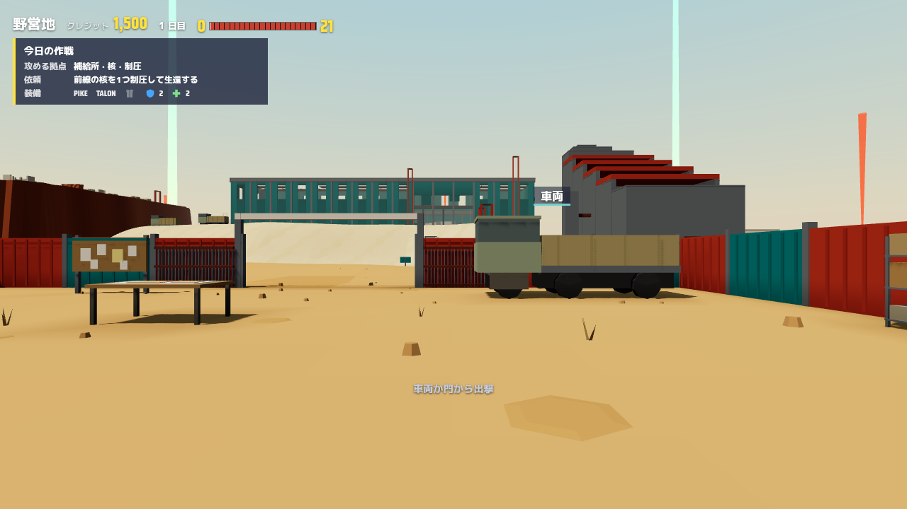

| 見える | 分からないこと |
| --- | --- |
| 今日の作戦（攻める拠点＝補給所・核・制圧）、車両 / 門から出撃 | **他プレイヤーの気配がゼロ**。守りも攻めも対人ではない |
| 地図の机は机としてあるだけ | 机を開くまで海の向こうの島は見えない |

**要約:** 初日から対人は語られない。線の入口は「前線の核を制圧」だけ。

### 1.2 地図の机（1 日目）

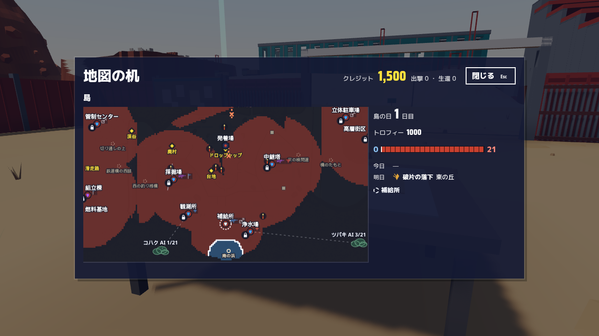

| 見える | 分からないこと |
| --- | --- |
| 島全体、赤い陣地、トロフィー 1000 | トロフィーが何の勝負か |
| 地図の縁に「コハク AI」「ツバキ AI」など | **だから何？** 見てよいだけ？ 敵？ いつ来る？ 攻められる？ |
| 前線の印（補給所） | 対人と無関係に見える |

**要約:** 「他がいるっぽい」はここで初めて出るが、意味・期限・自分の一手が無い。

### 1.3 信号所（1 日目）

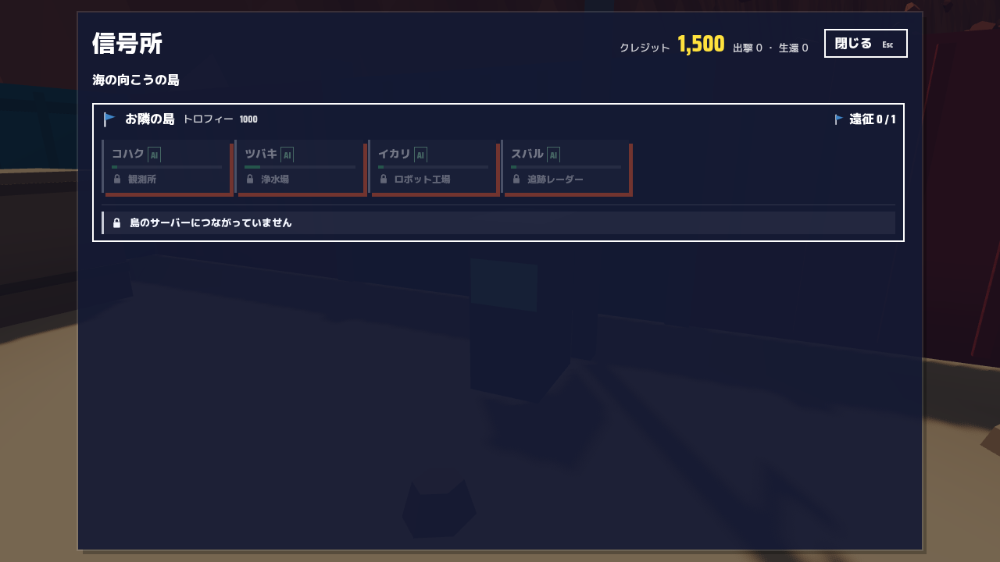

| 見える | 分からないこと |
| --- | --- |
| お隣の島（すべて錠・観測所など拠点名） | 錠＝航路未開放、という因果が書かれていない |
| 「遠征 0/1」 | ボタンは無いのに数が並ぶ → **攻めの入口に見える** |
| 「島のサーバーにつながっていません」 | 対人が壊れているように読める（AI の島は動く） |

**要約:** 攻めに行く方法はここには無い（設計どおり）が、見た目は「遠征の司令室」のまま。初見はここで行き詰まる。

### 1.4 出撃（1 日目）

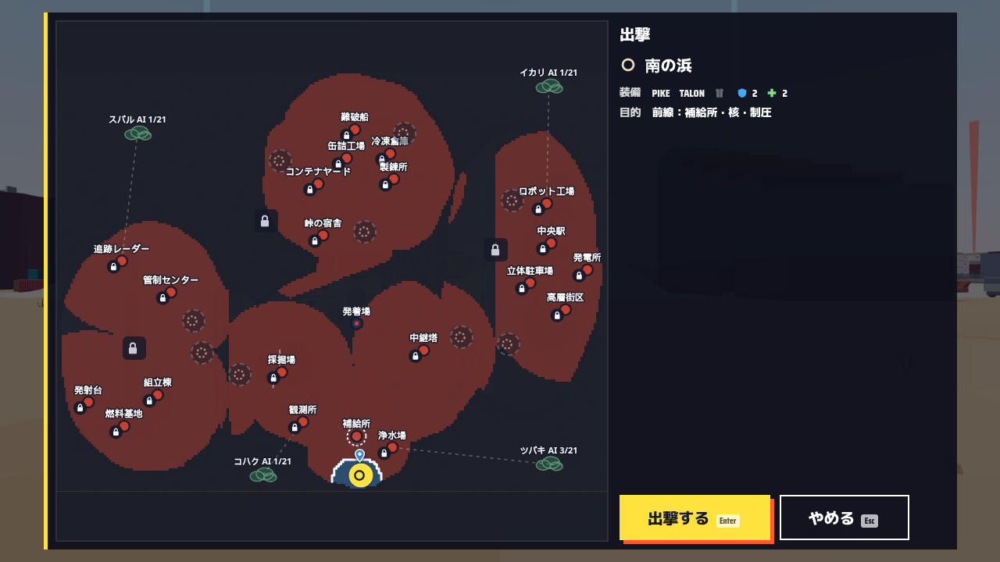

| 見える | 分からないこと |
| --- | --- |
| 縁のお隣、目的「前線：補給所 · 核 · 制圧」 | 縁の島を選ぶ操作が無い |
| 出撃する | 対人の攻め先はまだ無い（航路未開放）のに島は並ぶ |

**要約:** お隣は装飾。出撃＝自分の島の PvE 前線、としか読めない。

---

### 1.5 野営地（中盤・来る遠征あり）

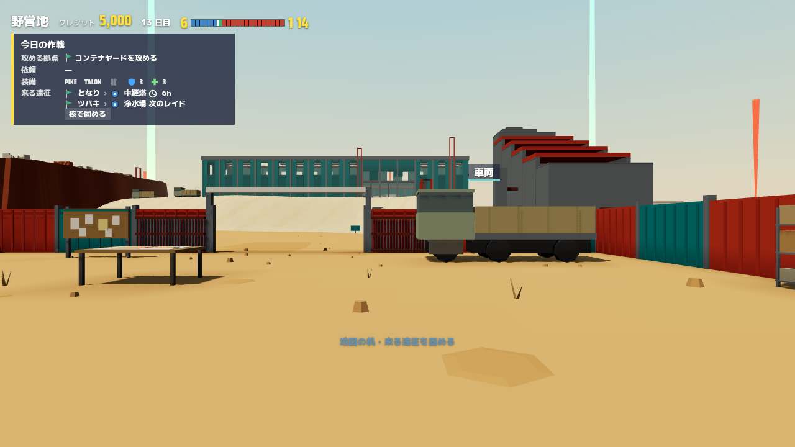

| 見える | 分からないこと |
| --- | --- |
| 今日の作戦に「コンテナヤードを攻める」と「来る遠征」（となり→中継塔 6h、ツバキ→浄水場 次のレイド）が**同居** | 今日は守る日か攻める日か。どちらが先か |
| 足元の次の一手「地図の机 · 来る遠征を固める」 | 「固める」＝出撃して核、が机の外では未説明 |
| 車両 | 守り用の出撃と攻め用の出撃が同じ入口 |

**要約:** 情報は揃い始めたが、攻めと守りが同じカードに並び、優先が一目ではない。

### 1.6 地図の机（中盤）

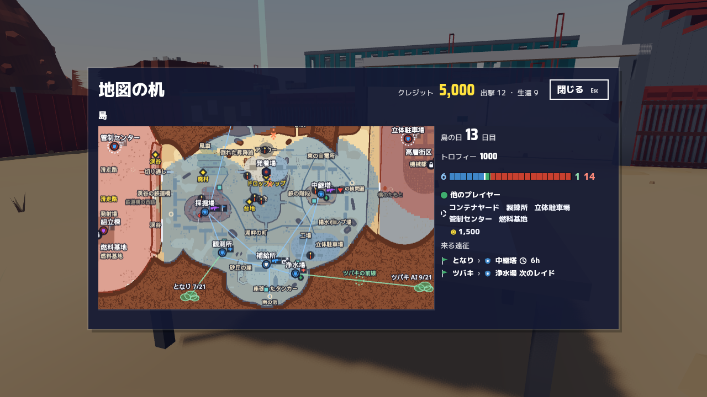

| 見える | 分からないこと |
| --- | --- |
| 来る遠征: 誰 → どこ → 6h / 次のレイド | **自分は何を押せばいいか**（机に「固める」ボタンは無い） |
| 地図上「ツバキの前線」、縁のとなり / ツバキ | 前線印＝短いレイドの入口、が側板に無い |
| 凡例「他のプレイヤー」の直下に拠点名の列 | その列は**前線の拠点名**で、他プレイヤーの所持一覧ではない（読み違いやすい） |
| 綱引き帯の緑 1 | 緑＝他プレイヤーの陣地、と凡例が弱い |

**要約:** 「誰が・どこへ・いつ」は側板にある。地図上の矢印・印との対応と、「だから出撃して核で固める / 攻める」が欠けている。

### 1.7 信号所（中盤）

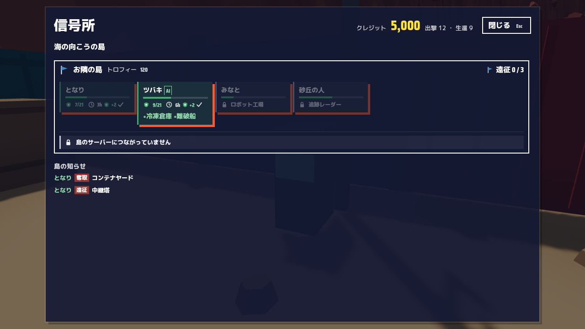

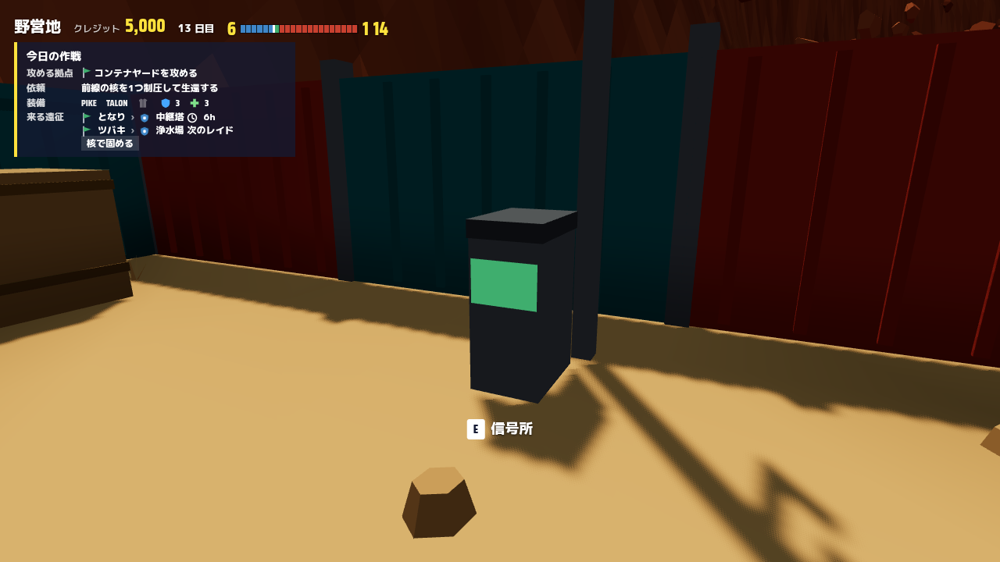

| 見える | 分からないこと |
| --- | --- |
| お隣カード、島の知らせ（奪取・遠征） | 知らせから攻めに行く一手が無い（設計どおりだが、仕返しの抜け道に見える） |
| 遠征 0/3 | 出している部隊の枠に見えるが、攻め入口ではない |
| AI を開くと拠点一覧（送信ボタン無し） | 「見られるだけ」と「攻められない」の差が弱い |

**要約:** 知らせの控えとしては足りる。攻めの入口に見える残骸（遠征 n/m）が残っている。

### 1.8 出撃（中盤・守り情報つき）

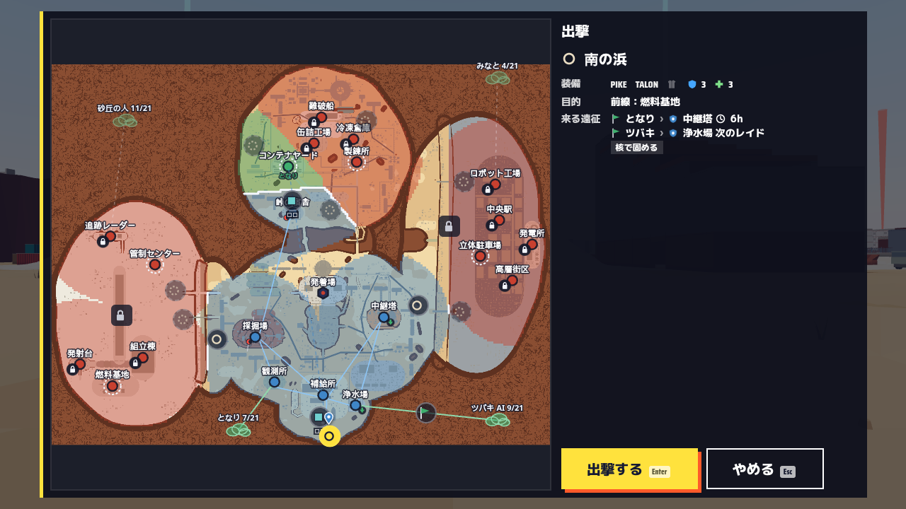

| 見える | 分からないこと |
| --- | --- |
| 来る遠征＋「核で固める」 | 選ばれているのは南の浜のまま。**狙われている拠点へ出る導線が無い** |
| 目的「前線：燃料基地」 | 守りと PvE 前線が同時に出る |

**要約:** 文言は正しいが、選択と目的が守りに寄せない。

### 1.9 出撃で「○○の前線」を選んだとき（攻め入口）

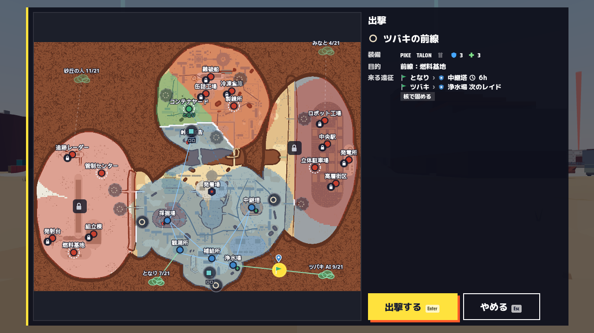

| 見える | 分からないこと |
| --- | --- |
| 見出し「〇 ツバキの前線」 | **目的はまだ「前線：燃料基地」**（自分の島の PvE）。選択と目的が矛盾 |
| 来る遠征にツバキ→浄水場も並ぶ | 同じ名前が「来る側」と「攻め先」で並び、攻め／守りが混線 |
| ボタン「出撃する」 | 実際は予告を立てる／短いレイドへ、が「いつもの出撃」に見える |
| 印は地図上の旗だけ | 矢印キーか地図クリックでしか辿れない。リストに「攻める」が無い |

**要約:** 攻めの入口は存在するが、選んでも側板が対人攻めに切り替わらない。初見では発見しづらく、発見しても意味が伝わらない。

### 1.10 他プレイヤー陣地（自分の島）とキャンプ

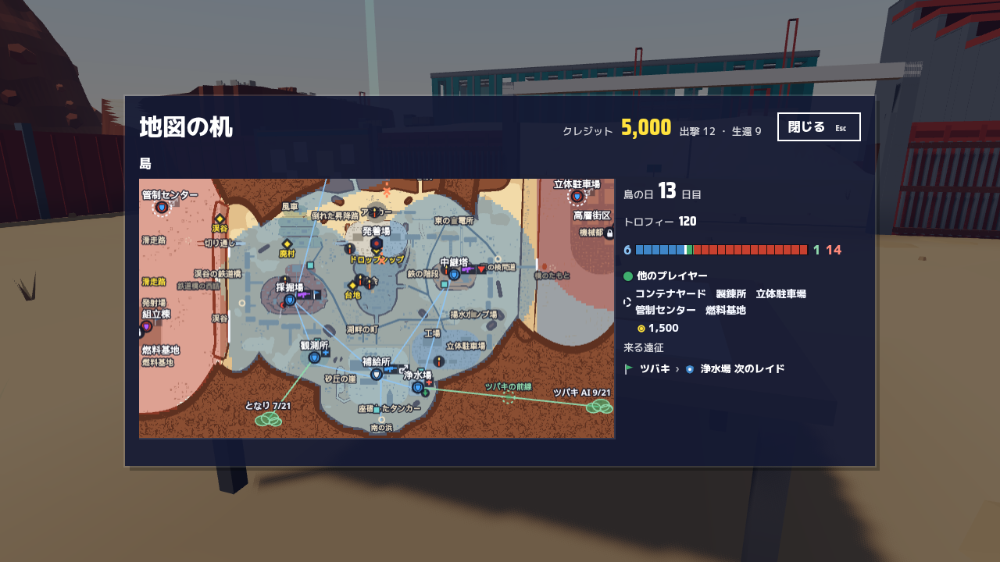

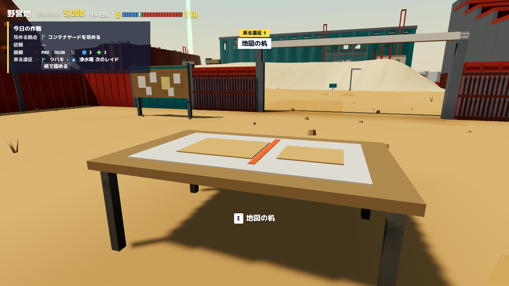

| 見える | 分からないこと |
| --- | --- |
| 今日の作戦「コンテナヤードを攻める」 | 地図のどこがそれか、色だけで追うのが難しい |
| 凡例「他のプレイヤー」 | 下の拠点名リストとの関係が誤解を生む（§1.6） |

### 1.11 レイド中の着陸（参考）

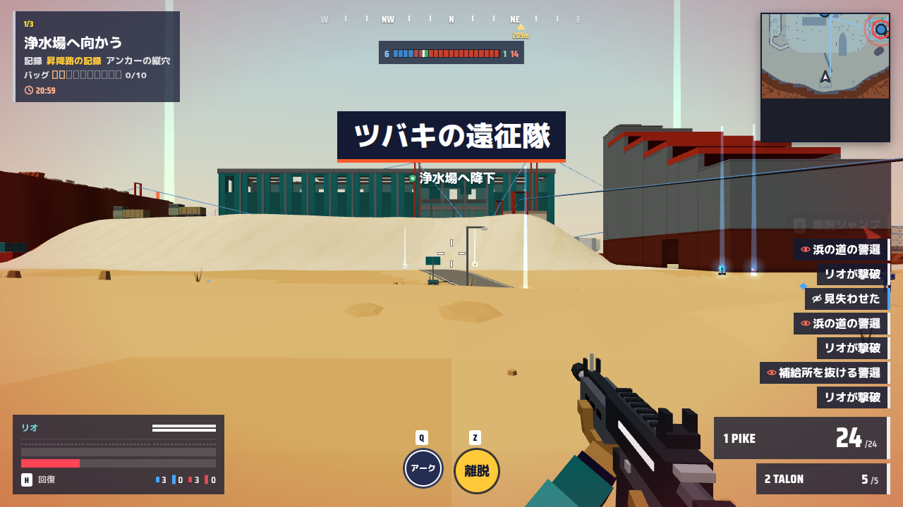

野営では予告だったものが、レイド中はバナーで「誰の遠征隊／どこへ」と出る。**野営側の方が薄い**。

---

## 2. 画面ごとの「分からなさ」要約

| 画面 | スクショ | 分からなさ（一文） |
| --- | --- | --- |
| 野営地（序盤） | `01-fresh-camp.png` | 対人が存在しない |
| 地図の机（序盤） | `02-fresh-map-table.png` | お隣は見えるが意味も一手も無い |
| 信号所（序盤） | `03-fresh-signal.png` | 攻め司令室に見えるが攻められない |
| 出撃（序盤） | `04-fresh-depart.png` | お隣は飾り、出撃は PvE 前線のみ |
| 野営地（中盤） | `10-mid-camp-tip.png` | 攻めと守りが同居し優先が不明 |
| 地図の机（中盤） | `11-mid-map-incoming.png`, `150-expeditions-map.png` | 誰・どこ・いつはある。次の操作が机の外 |
| 信号所（中盤） | `12-mid-signal-news.png`, `156-camp-signal.png` | 知らせはある。攻め入口の残骸が残る |
| 出撃（守り） | `13-mid-depart-incoming.png` | 固めろと言うがスタートが脅威拠点でない |
| 出撃（○○の前線） | `15-depart-assault-selected.png` | 攻めを選んでも目的が PvE のまま |
| 他プレイヤー陣地 | `20-rival-hold-map.png`, `21-rival-hold-camp.png` | 「攻める」はあるが地図との対応が弱い |
| レイド着陸 | `158-expeditions-landing.png` | 戦闘中の方が野営より分かりやすい |

---

## 3. 案（優先度順・削ってシンプル）

方針: **要素を増やすより、入口を一つにまとめ、守りと攻めを同じ型で見せる。** 参考はクラッシュ・オブ・クランズ（攻撃ボタン／防衛ログ）、Travian（着弾タイマー）、Rise of Kingdoms（行軍線）、Boom Beach（島マップ上の明示的な攻撃）。

### 案 1（最優先）— 地図の机を「今日の対人」一枚に

**今分からないこと:** 来る遠征・攻める拠点・お隣・トロフィーが机・今日の作戦・信号所・出撃に分散。

**変え方（削る・まとめる）:**

- 地図の机の側板を **守り 1 行 + 攻め 1 行** だけにする（CoC の防衛ログ＋攻撃ボタンに相当）。
- 今日の作戦から来る遠征／攻める拠点の重複を削るか、机への一行ポインタだけ残す。
- 信号所から「遠征 n/m」見出しを削る（または「島の守り」だけに）。

**効果:** 「対人は机」と覚えられる。次の一手が常に同じ場所。

### 案 2 — 守りと攻めを同じカード型に

**今分からないこと:** 守りは「来る遠征」印、攻めは「〜を攻める」や地図の旗で、型が違う。

**変え方:**

| | 誰 | どこ | いつ | 自分は |
| --- | --- | --- | --- | --- |
| 守り | となり | 中継塔 | 6h | **固める**（出撃） |
| 攻め | ツバキ | ツバキの前線 / コンテナヤード | いま / 予告あと n 時間 | **攻める**（出撃） |

入口はどちらも **車両 / 門からの出撃一つ**。

**効果:** Travian の着弾行と攻撃行が対称なように、読む欄が一つになる。

### 案 3 — 攻めの入口を一つにする（地図の「攻める」だけ）

**今分からないこと:** E4（自分の島の陣地）と短いレイド（○○の前線）と信号所の見た目が、別ゲームに見える。

**変え方:**

- 机と出撃の側板に **攻める先リストを一つ**（自分の島の他プレイヤー陣地＋開いた ○○の前線）。
- 地図の旗印はリストの選択と同期するだけ（発見ゲーをやめる）。
- 信号所は知らせ・トロフィーのみ（お隣カードは「見る」に限定し、攻め語を出さない）。

**効果:** 「他の人の拠点を攻めに行く方法」が机→出撃の一本道になる。

### 案 4 — 出撃の目的を選択に追従させる

**今分からないこと:** 「ツバキの前線」を選んでも目的が「前線：燃料基地」、ボタンが「出撃する」のまま（`15-depart-assault-selected.png`）。

**変え方:**

- 攻め選択時: 目的＝「ツバキを攻める」、ボタン＝攻める / 短いレイド（予告中は待ち文言）。
- 来る遠征がある日: 既定スタートを狙われている拠点寄りにするか、目的の先頭を「中継塔を固める」に。

**効果:** 選んだ瞬間に「守り／攻め」が確定する。実装は表示寄せが中心。

### 案 5 — 地図に行軍線（または矢印）だけ残す

**今分からないこと:** 側板の印と地図上の拠点が目でつながらない。RoK の行軍線が無い。

**変え方:**

- 来る遠征: お隣 → 狙われる拠点へ一本の線＋拠点横に 6h / 次のレイド。
- 攻め選択時: 自分 → ○○の前線へ同じ色の逆向き線。
- 側板の印の重複は短くする（線があるなら「核で固める」CTA だけ）。

**効果:** 「いつ来るか／どこへ」が地図だけで読める。印の字を増やさない。

### 案 6 — 序盤のお隣ノイズを削る

**今分からないこと:** 1 日目から縁に AI の島が並び、「いるっぽい」だけが残る（`02` / `04`）。

**変え方:**

- 航路が一つも開くまでは、縁のお隣を薄くする／「航路が開くとお隣と戦える」一行だけ。
- または最初の海岸拠点を取った日にだけ、お隣を強調（Boom Beach の島が段階的に見える感じ）。

**効果:** 「いる → だから何」のギャップを、触れるタイミングまで先送りする。

### 案 7 — 凡例と前線リストの誤解を削る

**今分からないこと:** 「他のプレイヤー」の直下が前線拠点名に見え、誰の陣地か分からない（`11` / `20`）。

**変え方:**

- 色の凡例と「今日の前線」を見出しで分ける。
- 他プレイヤーの陣地は地図上の名前をその色で出し、側板には「コンテナヤード（となり）」のように**拠点＋持ち主**だけ。

**効果:** 表示の削減とラベル付けだけで誤解が減る。

### 案 8（任意）— 野営の今日の作戦を対人優先の一日一行に

**今分からないこと:** 攻める拠点と来る遠征が同じカードで競合（`10`）。

**変え方:** 来る遠征がある日は作戦を「守り: …を固める」一行にし、攻めは机のリストへ。逆の日は「攻め: …」。

**効果:** CoC の「今日は防衛／今日は攻撃」に近い。案 1 とセット。

---

## 4. 推奨スタック（実装フェーズ用・本紙ではやらない）

1. **案 1 + 2**（机に守り／攻め対称カード、入口は出撃一つ）  
2. **案 4**（出撃側板の追従——矛盾が一番目立つ）  
3. **案 3**（攻めリスト一本化、信号所から遠征数を消す）  
4. **案 5 + 7**（地図の線と凡例の整理）  
5. **案 6 + 8**（序盤ノイズと今日の作戦の優先）

守りと攻めの対称: どちらも「誰・どこ・いつ・CTA（固める／攻める）」→ 同じ出撃。信号所は入口にしない。

---

## 5. 文言案（提案のみ・【元／案／理由】）

実装・採用はしない。議論用。

| # | 元 | 案 | 理由 |
| --- | --- | --- | --- |
| 1 | 来る遠征（側板の見出しだけ） | 守り · 来る遠征 | 攻めと対になる語を先に出す |
| 2 | （目的）前線：燃料基地（○○の前線選択中） | ツバキを攻める · 短いレイド | 選択と目的の矛盾を解消 |
| 3 | 出撃する（○○の前線選択中） | 攻める（予告中は「予告を立てる」） | CoC の攻撃ボタンに寄せる |
| 4 | 遠征 0/3（信号所見出し） | （削除）または 島の守り n | 攻め入口に見えないようにする |
| 5 | 他のプレイヤー（凡例の直下に拠点名） | 凡例は色だけ／前線は「今日の前線」見出し | 読み違いを止める |
| 6 | 核で固める（小さく） | 中継塔を固める · 出撃 | どこへ行くかを名前で出す |
| 7 | 地図の机 · 来る遠征を固める | 地図の机 · 守りを見る | 机が対人ボードだと分かる |
| 8 | 島のサーバーにつながっていません | 本物のお隣はオフライン · AI の島は遊べる | 壊れている印象を減らす |
| 9 | ツバキの前線（印のみ） | 攻める · ツバキの前線 | 印が入口だと分かる |
| 10 | （なし・1 日目のお隣） | 航路が開くとお隣と戦える | 「いるっぽい」だけの状態を説明 or 非表示 |

---

## 6. やらないこと（本紙の範囲）

- UI / ルールの実装、copy.ts の採用コミット
- 信号所への攻めボタン復活（案 A / E4 と逆行）
- 新しい対人モードやロビー
- マージ（レビュー後に人間が判断）

---

## 7. 参照

- [multiplayer-experience.md](multiplayer-experience.md) — 案 A、守りは地図・攻めは地図
- [game-design-review.md](game-design-review.md) §5.8 — 短いレイド
- [glossary.md](glossary.md) — 画面の語
- [design-direction.md](design-direction.md) — 拠点主役・非同期の攻守
