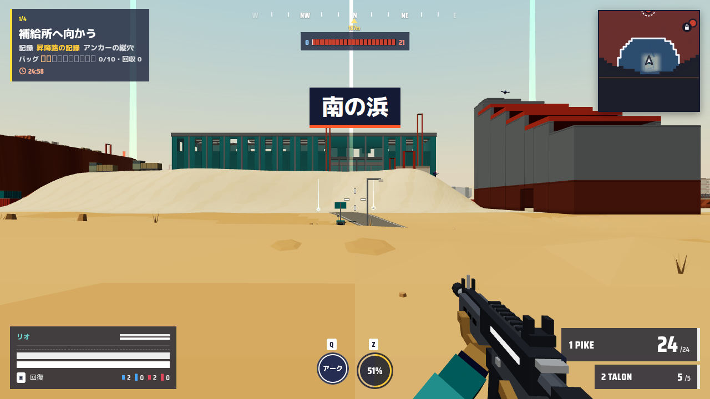

# RINGFALL UX 設計（体験の再設計）

プレイヤーが画面を見て「次に何をすればいいか」分かり、触れるほど仕組みが分かるようにするための設計メモ。性能改善（#163, #164）のあとに、表示・操作・マルチプレイのつながりを整える。

関連: [brief.md](brief.md)（製品の正本）、[ui.md](ui.md)（画面の決めごと）、[island-v2.md](island-v2.md)、[multiplayer.md](multiplayer.md)。

実装履歴: Round 1 = PR #167（使用対象・HUD 整理）。Round 2 = 本枝（オンボーディング表示・マルチ導線・ピン）。

---

## 1. いまの問題（監査）

監査はクライアントコード（`src/ringfall/view/hud.ts`、`sim/world.ts` ほか）の読み取りと、Playwright での実プレイ撮影（`docs/ringfall/img/before-*.png`）によった。

### 1.1 画面が詰まっている

| 現象 | 根拠 | 重さ |
| --- | --- | --- |
| 出撃直後の目的カードに「記録」「バッグ 0/10・回収 0」「時計」「島の帯」が同時に並ぶ |  | 高 |
| 野営地で設備ラベルが密集し、依頼板と地図の机が重なって見える |  | 高 |
| 戦闘中も常時ステルス語・島帯・物語行が残る |  | 中 |
| 羅針盤・ミニマップ・バイタル・アビリティ・武器が四隅を埋める | 同上 | 中（構成は維持、密度を下げる） |

### 1.2 インタラクトが取りにくい

| 現象 | コード | 重さ |
| --- | --- | --- |
| 距離だけ・向きなし・粘りなしで毎フレーム再選定 | 旧 `useTarget`（`sim/world.ts`） | 高 |
| 世界側に「今の対象」のハイライトがない（プロンプト文字のみ） | `Hud.prompt` DOM のみ | 高 |
| 重なった対象を切り替える手段がない | キーバインドに無し | 高 |
| 野営地の設備も最近傍のみ | `campSpotAt` | 中 |

### 1.3 システムがばらばらに感じる

レイド（漁る・戦う・帰る）、陣取り戦、依頼／物語、隠れ家／工場、遠征（マルチ）が、それぞれ別の板・別の言葉で出る。目的カードは `objectiveSteps()` で一本化されているが、周辺の常時表示がそれを薄める。

### 1.4 初めての人が次の一手を取りにくい

南の浜スポーンで「補給所へ向かう」は出るが、同時に物語記録・空バッグ・島帯が並び、視線が散る。野営地は設備ラベルが多く、「今日の作戦 → 出撃」の一本道が弱い。

### 1.5 マルチが別モードに見える

遠征・島コード・来る遠征は信号所に閉じている。レイド中のライバル部隊は世界に出るが、初めてのプレイヤーは信号所を開くまで存在を知りにくい。

---

## 2. 統一コンセプト

**一本のループ:** 「島に出て、前線を押し、持ち帰って拠点を育てる」。

```
野営地で今日を決める → レイドで漁る／核を取る → 生還して精算 → 拠点と工場が強くなる → また出る
         ↑________________________________ 遠征・他島の痕跡は、このループの途中で自然に顔を出す ________________________________↓
```

各システムはこの幹への枝とする。

| 枝 | 幹へのつながり | プレイヤーが学ぶきっかけ |
| --- | --- | --- |
| 補給箱・カバン | 持ち帰りの中身 | 触ると開く／拾う |
| 核・陣取り戦 | 島の帯が青へ動く | 目的カード＋ビーコン |
| 中継ボックス | 生還保険・出発点 | 近づくと起動 |
| 依頼／物語 | その日の行き先の色付け | 依頼板（任意） |
| 隠れ家／工場 | 次のレイドの余力 | 野営地の設備（必要になったら） |
| 遠征・ライバル | 同じ陣取りの相手側 | 地図の緑・来る遠征・信号所 |

---

## 3. HUD 情報階層

原則は [ui.md](ui.md)「1 画面 1 つ」と brief の「目印は目的の行き先 1 つ」に従う。

### 常時（Always）

- バイタル（HP／シールド／回復）
- 武器スロットと照準
- 羅針盤＋目的の印 1 つ
- 目的カードの**今の手順**（大きく）
- バッグ枠数（中身の価値は 0 のとき出さない）※ Round 1

### 文脈（Contextual）

- ステルス語：見られている／警戒／交戦／見失わせた、だけ。未発見は出さない ※ Round 1
- 脱出地点：動きがあるときだけ（既存 CSS）
- 使用プロンプト：対象があるときだけ＋世界の輪 ※ Round 1
- 島の帯の強調：奪い合い・脅威があるとき。平常時は薄く（`#island-row.calm`）※ Round 2 / I4
- 物語行：2 回目以降のレイド、または記録を取った／目的にしたとき ※ Round 2 / I5
- ローカルピン（P）：羅針盤と地図に短い印 ※ Round 2 / M4

### 隠す／開くまで出さない（Hidden）

- 全体地図（M）
- カバンの中身（Tab 押し）
- 野営地の各パネル
- 信号所の遠征 UI
- 設定（タイトル／ポーズ）

### 文言（採用済み）

| 元 | 案 | 理由 | 状態 |
| --- | --- | --- | --- |
| バッグ n/10・回収 0 | バッグ n/10（回収は価値が付いてから） | 空の「回収 0」は情報にならない | Round 1 実装 |
| 未発見 | （空） | 平常時の常時表示がノイズ | Round 1 実装 |
| 調べる・拾う | 使う | 対象が箱以外にも広がったため（キー一覧） | **Round 2 実装（承認済み）** |
| 対象切替 | 対象を切り替える | T キー追加に合わせたキー一覧 | Round 1 で「対象切替」追加。言い回しは下表で承認待ち |

### 文言変更案（実装せず承認待ち）

| 元 | 案 | 理由 |
| --- | --- | --- |
| 対象切替 | 対象を切り替える | キー一覧の読みやすさ |
| ピン | 印を置く | 「ピン」が外来語で馴染まない場合の代替 |
| 来る遠征あり · 地図の机 | 来る遠征 · 地図で固める | 野営プロンプトの次の一手をより具体に |
| 信号所へ | 遠征・島の番号へ | 工場ボタンのラベルを中身寄りに |

---

## 4. インタラクト選定仕様

### 目標

届く範囲に複数あっても、**今の 1 対象**が決まり、プロンプトと世界の印が一致し、迷ったら切り替えられる。

### スコア（低いほど優先）

```
score = 距離 − 向きの割引 − 種類の優先
```

- **向きの割引:** 正面で最大 `USE.face` m 相当（`config.ts`）
- **種類の優先:** `USE.prefer`（箱＞武器＞ジップ、デポは譲る、など）
- **味方蘇生:** 従来どおり最優先（他と競合しない）

### ヒステリシス

`State.useFocus` に安定 ID（`bin:3` など）を保持。別候補が現フォーカスより `USE.stick` 以上良くなるまで切り替えない。

### サイクル

キー `T`（`cycleUse`）。候補をスコア順に一周。スマホは当面プロンプトのタップ対象 1 つのまま（将来: 長押しで切替を提案）。

### ハイライト

焦点の足元にシアンの輪（`World.setUseMark`）。プロンプトは 1 行。複数時は薄い `T` 印。

### 野営地

`campSpotAt` も向きを加味（近いが背後の設備より、向いている設備を選ぶ）。

**実装状況:** Round 1 でレイドの選定・ハイライト・T 切替・野営地の向きを実装。テストは `npx tsx scripts/ringfall-use.ts`。

---

## 5. オンボーディング（触って覚える）

段階は「機能をロックする」より「まだ出さない／静かにする」。

| 段階 | 見えるもの | まだ出さない／薄くする |
| --- | --- | --- |
| 0 タイトル | 野営地へ | 操作一覧は折りたたみ可（提案） |
| 1 野営地初日 | 今日の作戦・出撃の車両・近傍ラベル | 遠い設備ラベル・工場／信号所の詳細 |
| 2 初レイド | 目的 1 手順・ビーコン・プロンプト | 空の回収・未発見・物語行（初回） |
| 3 初生還 | 結果の島地図・持ち帰った物 | — |
| 4 依頼板 | 導入クエスト 4 つ | 強度の高い契約 |
| 5 前線を知る | 核のプロンプト・島の帯の動き | 平常時の島帯は薄い |
| 6 信号所 | 島コード・遠征（隣人か AI）・工場からの導線 | — |

Round 2 で実装:

1. **I3** 野営地ラベルは到達／接近時のみ（車両は遠方でも、マーク付きは 12 m まで）— 安全側: マーク付きを完全非表示にはしない
2. **I5** 初レイドは物語行を隠す（`raidsDone === 0` かつ記録未所持／非目的）
3. 野営で設備が遠いときの短い次の一手（来る遠征／初日出撃）— プロンプト行に 1 行

代替案（未採用）: マーク付き設備も常に到達時のみ → 依頼の未読を見失いやすいので見送り。

---

## 6. マルチプレイの織り込み

現状は非同期遠征（[multiplayer.md](multiplayer.md)）。別モードではなく陣取りの「もう一方の色」。

### 自然に出会う案

| 案 | 内容 | 労力 | 優先 | 状態 |
| --- | --- | --- | --- | --- |
| A 痕跡 | ライバル接触を地図上で緑の輪（接触ドットの外周） | M | 高 | **Round 2 実装（M3・表示のみ）** |
| B 共有目的 | 「来る遠征」を今日の作戦に 1 行 | S | 高 | **Round 2 実装（M1）** |
| C 受け渡し | デポに「預け荷物」を他遠征が拾える | L | 中 | 未着手 |
| D ピン／エモート | 視線先への短いピン（ビューのみ、sim 非接触） | M | 中 | **Round 2 実装（M4・ローカル）** |
| E 信号所の入口 | 工場パネルから信号所へボタン | S | 高 | **Round 2 実装（M2）** |

ステージ:

1. **済（表示）:** B / E / A の接触輪 / D のローカルピン
2. **次:** A のレイド内痕跡を箱・道にも広げる（決定性を崩さないハッシュ配置）
3. **その後:** 同期ピン（島 DO）→ C

代替案（未採用）: ピンを sim に載せる → 決定性とベンチに触れるのでビュー専用を選んだ。

---

## 7. ロードマップ（提案の労力・優先）

| ID | 提案 | 労力 | 優先 | 状態 |
| --- | --- | --- | --- | --- |
| I1 | 使用対象のスコア＋ヒステリシス＋T 切替＋輪 | M | 最高 | **Round 1 済** |
| I2 | 未発見／回収 0 の非表示 | S | 高 | **Round 1 済** |
| I3 | 野営地ラベルを到達時のみ | M | 高 | **Round 2 済** |
| I4 | 島帯を平常時に薄く | S | 中 | **Round 2 済** |
| I5 | 物語行の初回抑制 | S | 中 | **Round 2 済** |
| M1 | 今日の作戦に来る遠征 1 行 | S | 高 | **Round 2 済** |
| M2 | 工場→信号所導線 | S | 高 | **Round 2 済** |
| M3 | 他プレイヤー痕跡（接触の緑輪） | M | 高 | **Round 2 済（接触のみ）** |
| M4 | ピン（ローカル・ビュー） | M | 中 | **Round 2 済** |
| C1 | 文言【元/案/理由】の追加採用 | S | — | オーナー判断（§3 承認待ち表） |
| M5 | 痕跡を箱／道へ拡張 | M | 高 | 次ラウンド候補 |
| M6 | 同期ピン（島 DO） | L | 中 | 次ラウンド候補 |
| C2 | デポの預け荷物（軽量協力） | L | 中 | 後回し |

労力: S 半日未満 / M 数ファイル / L システム跨ぎ。

---

## 8. 撮影一覧

| ファイル | 状態 |
| --- | --- |
| `img/before-01-title.png` … `before-13-results.png` | Round 1 改修前 |
| `img/after-*.png` | Round 1 改修後 |
| `img/r2-before-*.png` | Round 2 前（= Round 1 after） |
| `img/r2-after-01` … `13` | Round 2 後（同シナリオ） |
| `img/r2-after-14-factory-signal.png` | 工場パネルの「信号所へ」 |
| `img/r2-after-15-factory-to-signal.png` | 工場から信号所へ遷移 |
| `img/r2-after-16-ping.png` / `17-map-ping.png` | ローカルピン（羅針盤／地図） |

再撮影: `node scripts/ringfall-ux-shots.mjs --tag before|after|r2-before|r2-after`（要 `npm run build`）。
