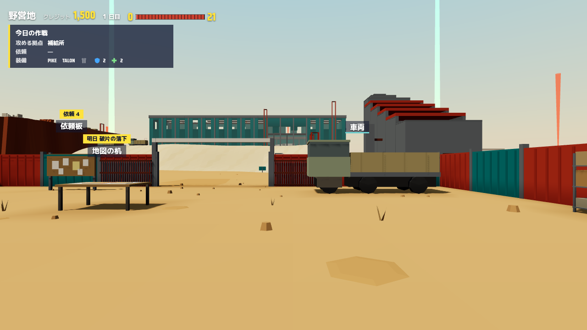
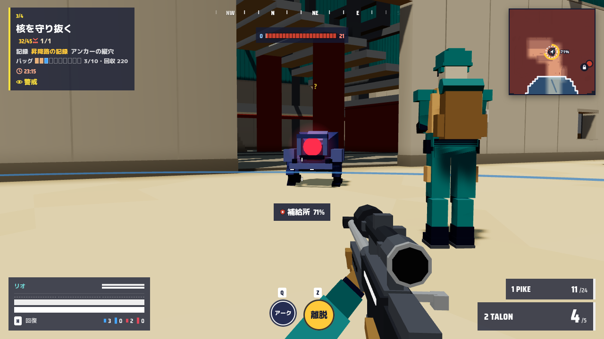

# RINGFALL UX 設計（体験の再設計）

プレイヤーが画面を見て「次に何をすればいいか」分かり、触れるほど仕組みが分かるようにするための設計メモ。性能改善（#163, #164）のあとに、表示・操作・マルチプレイのつながりを整える。

関連: [brief.md](brief.md)（製品の正本）、[ui.md](ui.md)（画面の決めごと）、[island-v2.md](island-v2.md)、[multiplayer.md](multiplayer.md)。

---

## 1. いまの問題（監査）

監査はクライアントコード（`src/ringfall/view/hud.ts`、`sim/world.ts` ほか）の読み取りと、Playwright での実プレイ撮影（`docs/ringfall/img/before-*.png`）によった。

### 1.1 画面が詰まっている

| 現象 | 根拠 | 重さ |
| --- | --- | --- |
| 出撃直後の目的カードに「記録」「バッグ 0/10・回収 0」「時計」「島の帯」が同時に並ぶ |  | 高 |
| 野営地で設備ラベルが密集し、依頼板と地図の机が重なって見える |  | 高 |
| 戦闘中も常時ステルス語・島帯・物語行が残る |  | 中 |
| 羅針盤・ミニマップ・バイタル・アビリティ・武器が四隅を埋める | 同上 | 中（構成は維持、密度を下げる） |

### 1.2 インタラクトが取りにくい

| 現象 | コード | 重さ |
| --- | --- | --- |
| 距離だけ・向きなし・粘りなしで毎フレーム再選定 | 旧 `useTarget`（`sim/world.ts`） | 高 |
| 世界側に「今の対象」のハイライトがない（プロンプト文字のみ） | `Hud.prompt` DOM のみ | 高 |
| 重なった対象を切り替える手段がない | キーバインドに無し | 高 |
| 野営地の設備も最近傍のみ | `campSpotAt` | 中 |

### 1.3 システムがばらばらに感じる

レイド（漁る・戦う・帰る）、陣取り戦、依頼／物語、隠れ家／工場、遠征（マルチ）が、それぞれ別の板・別の言葉で出る。目的カードは `objectiveSteps()` で一本化されているが、周辺の常時表示がそれを薄める。

### 1.4 初めての人が次の一手を取りにくい

南の浜スポーンで「補給所へ向かう」は出るが、同時に物語記録・空バッグ・島帯が並び、視線が散る。野営地は設備ラベルが多く、「今日の作戦 → 出撃」の一本道が弱い。

### 1.5 マルチが別モードに見える

遠征・島コード・来る遠征は信号所に閉じている。レイド中のライバル部隊は世界に出るが、初めてのプレイヤーは信号所を開くまで存在を知りにくい。

---

## 2. 統一コンセプト

**一本のループ:** 「島に出て、前線を押し、持ち帰って拠点を育てる」。

```
野営地で今日を決める → レイドで漁る／核を取る → 生還して精算 → 拠点と工場が強くなる → また出る
         ↑________________________________ 遠征・他島の痕跡は、このループの途中で自然に顔を出す ________________________________↓
```

各システムはこの幹への枝とする。

| 枝 | 幹へのつながり | プレイヤーが学ぶきっかけ |
| --- | --- | --- |
| 補給箱・カバン | 持ち帰りの中身 | 触ると開く／拾う |
| 核・陣取り戦 | 島の帯が青へ動く | 目的カード＋ビーコン |
| 中継ボックス | 生還保険・出発点 | 近づくと起動 |
| 依頼／物語 | その日の行き先の色付け | 依頼板（任意） |
| 隠れ家／工場 | 次のレイドの余力 | 野営地の設備（必要になったら） |
| 遠征・ライバル | 同じ陣取りの相手側 | 地図の緑・来る遠征・信号所 |

---

## 3. HUD 情報階層

原則は [ui.md](ui.md)「1 画面 1 つ」と brief の「目印は目的の行き先 1 つ」に従う。

### 常時（Always）

- バイタル（HP／シールド／回復）
- 武器スロットと照準
- 羅針盤＋目的の印 1 つ
- 目的カードの**今の手順**（大きく）
- バッグ枠数（中身の価値は 0 のとき出さない）※本 PR で実装

### 文脈（Contextual）

- ステルス語：見られている／警戒／交戦／見失わせた、だけ。未発見は出さない ※本 PR で実装
- 脱出地点：動きがあるときだけ（既存 CSS）
- 使用プロンプト：対象があるときだけ＋世界の輪 ※本 PR で実装
- 島の帯の強調：奪い合い・脅威があるとき（提案：平常時は薄く）
- 物語行／イベント行：進行中かつ目的と別のときだけ（現状維持、文言は提案）

### 隠す／開くまで出さない（Hidden）

- 全体地図（M）
- カバンの中身（Tab 押し）
- 野営地の各パネル
- 信号所の遠征 UI
- 設定（タイトル／ポーズ）

### 文言変更案（実装せず承認待ち）

| 元 | 案 | 理由 |
| --- | --- | --- |
| バッグ n/10・回収 0 | バッグ n/10（回収は価値が付いてから） | 空の「回収 0」は情報にならない ※回収 0 非表示は本 PR で実施 |
| 未発見 | （空） | 平常時の常時表示がノイズ ※本 PR で実施 |
| 調べる・拾う | 使う | 対象が箱以外にも広がったため（キー一覧） |
| 対象切替 | 対象を切り替える | T キー追加に合わせたキー一覧 ※本 PR で「対象切替」を追加済み。言い回しの承認待ち |

---

## 4. インタラクト選定仕様

### 目標

届く範囲に複数あっても、**今の 1 対象**が決まり、プロンプトと世界の印が一致し、迷ったら切り替えられる。

### スコア（低いほど優先）

```
score = 距離 − 向きの割引 − 種類の優先
```

- **向きの割引:** 正面で最大 `USE.face` m 相当（`config.ts`）
- **種類の優先:** `USE.prefer`（箱＞武器＞ジップ、デポは譲る、など）
- **味方蘇生:** 従来どおり最優先（他と競合しない）

### ヒステリシス

`State.useFocus` に安定 ID（`bin:3` など）を保持。別候補が現フォーカスより `USE.stick` 以上良くなるまで切り替えない。

### サイクル

キー `T`（`cycleUse`）。候補をスコア順に一周。スマホは当面プロンプトのタップ対象 1 つのまま（将来: 長押しで切替を提案）。

### ハイライト

焦点の足元にシアンの輪（`World.setUseMark`）。プロンプトは 1 行。複数時は薄い `T` 印。

### 野営地

`campSpotAt` も向きを加味（近いが背後の設備より、向いている設備を選ぶ）。

**実装状況:** 本 PR でレイドの選定・ハイライト・T 切替・野営地の向きを実装。テストは `npx tsx scripts/ringfall-use.ts`。

---

## 5. オンボーディング（触って覚える）

段階は「機能をロックする」より「まだ出さない／静かにする」。

| 段階 | 見えるもの | まだ出さない／薄くする |
| --- | --- | --- |
| 0 タイトル | 野営地へ | 操作一覧は折りたたみ可（提案） |
| 1 野営地初日 | 今日の作戦・出撃の車両 | 工場／信号所の詳細説明 |
| 2 初レイド | 目的 1 手順・ビーコン・プロンプト | 空の回収・未発見・物語の強調 |
| 3 初生還 | 結果の島地図・持ち帰った物 | — |
| 4 依頼板 | 導入クエスト 4 つ | 強度の高い契約 |
| 5 前線を知る | 核のプロンプト・島の帯の動き | — |
| 6 信号所 | 島コード・遠征（隣人か AI） | — |

提案（未実装・要判断）:

1. 野営地の初日、車両以外のラベルを使用キー到達時だけ出す（常時ラベル削減）— 労力 M / 優先 高
2. 初レイドの目的カードから物語行を、記録を取るまで隠す — 労力 S / 優先 中
3. 「次へ」の短いトーストを、野営地入場時にも 1 回 — 労力 S / 優先 中

---

## 6. マルチプレイの織り込み

現状は非同期遠征（[multiplayer.md](multiplayer.md)）。別モードではなく陣取りの「もう一方の色」。

### 自然に出会う案

| 案 | 内容 | 労力 | 優先 |
| --- | --- | --- | --- |
| A 痕跡 | 他プレイヤーが先日通った道に薄いマーカー／回収済み箱の印 | M | 高 |
| B 共有目的 | 「来る遠征」が既にあるが、野営地の今日の作戦にも 1 行出す | S | 高 |
| C 受け渡し | デポに「預け荷物」を他遠征が拾える（軽量協力） | L | 中 |
| D ピン／エモート | マップまたは視線先への短いピン（同期は島 DO のログで十分） | M | 中 |
| E 信号所の入口 | 工場パネルの「遠征 n」を押すと信号所へ（発見性） | S | 高 |

ステージ:

1. **今すぐ（表示）:** B と E — コピーと導線だけ
2. **次:** A のレイド内痕跡（シミュレーションは決定性を崩さないハッシュ配置）
3. **その後:** D → C

---

## 7. ロードマップ（提案の労力・優先）

| ID | 提案 | 労力 | 優先 | 状態 |
| --- | --- | --- | --- | --- |
| I1 | 使用対象のスコア＋ヒステリシス＋T 切替＋輪 | M | 最高 | **本 PR 実装** |
| I2 | 未発見／回収 0 の非表示 | S | 高 | **本 PR 実装** |
| I3 | 野営地ラベルを到達時のみ | M | 高 | 提案 |
| I4 | 島帯を平常時に薄く | S | 中 | 提案 |
| I5 | 物語行の初回抑制 | S | 中 | 提案 |
| M1 | 今日の作戦に来る遠征 1 行 | S | 高 | 提案 |
| M2 | 工場→信号所導線 | S | 高 | 提案 |
| M3 | 他プレイヤー痕跡 | M | 高 | 提案 |
| M4 | ピン | M | 中 | 提案 |
| C1 | 文言【元/案/理由】の採用 | S | — | オーナー判断 |

労力: S 半日未満 / M 数ファイル / L システム跨ぎ。

---

## 8. 撮影一覧

| ファイル | 状態 |
| --- | --- |
| `img/before-01-title.png` … `before-13-results.png` | 改修前 |
| `img/after-*.png` | 改修後（同シナリオ） |

再撮影: `node scripts/ringfall-ux-shots.mjs --tag before|after`（要 `npm run build`）。
